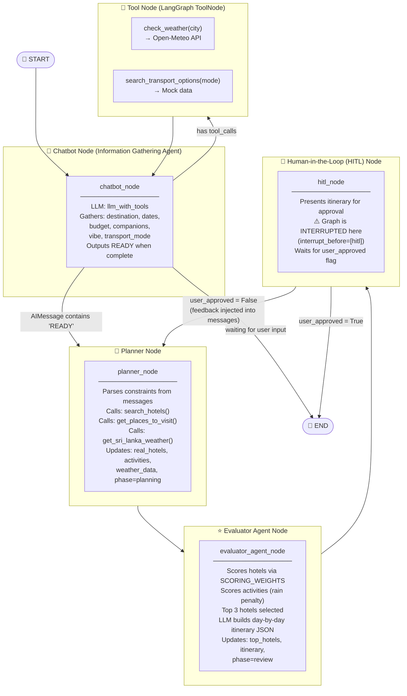
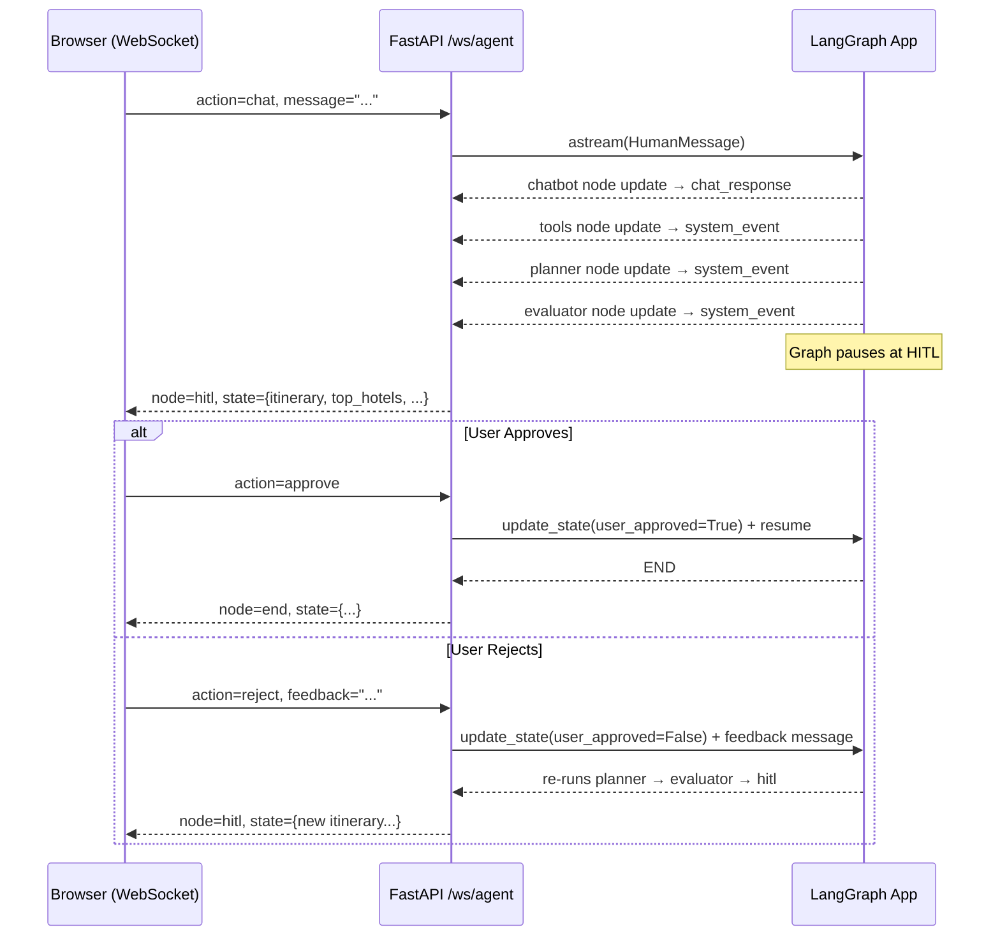

# 🗺️ TravelAgent — Agent Flow Diagram

This diagram reflects the actual LangGraph workflow defined in [`graph.py`](./graph.py).

---

## Agent Graph



---

## Node Descriptions

| Node | Role | LLM Used |
|---|---|---|
| **chatbot** | Information Gathering Agent — collects all 6 travel constraints from the user via natural conversation | `llm_with_tools` (Groq, temp=0) |
| **tools** | LangGraph `ToolNode` — executes tool calls made by the chatbot | — |
| **planner** | Fetches real hotels (Booking.com/Google), activities (DuckDuckGo scrape), and weather data | — (API calls only) |
| **evaluator** | Scores & ranks hotels and activities; uses LLM to produce a structured day-by-day itinerary | `planner_llm` (Groq, temp=0.2) |
| **hitl** | Presents the plan to the user; graph is **interrupted** here until the user approves or rejects | — |

---

## Tools Available to Chatbot

| Tool | Description | Data Source |
|---|---|---|
| `check_weather(city)` | Fetches real-time weather for a Sri Lankan city | Open-Meteo API (geocoding + forecast) |
| `search_transport_options(mode)` | Returns transport options for `rent_car` or `public_transport` | Mock data |

---

## External API Integrations (called by Planner)

| Function | Purpose | Source |
|---|---|---|
| `search_hotels()` | Searches real hotels by city & dates | Booking.com via RapidAPI → fallback to Google Places API |
| `get_places_to_visit()` | Finds activities matching user vibe | DuckDuckGo search + BeautifulSoup scrape (TripAdvisor / Reddit) |
| `get_sri_lanka_weather()` | Weather data for scoring | Open-Meteo API |
| `get_current_news()` | Sri Lanka news context | DuckDuckGo News (available but not wired into graph currently) |

---

## State Shape ([`state.py`](./state.py))

```
TravelState
├── messages          – conversation history (add_messages reducer)
├── constraints       – TravelConstraints (destination, dates, budget, companions, vibe, transport_mode)
├── phase             – "gathering" | "planning" | "review" | "booking" | "end"
├── weather_checked / weather_approved_by_user
├── real_hotels       – raw hotel list from API
├── hotel_search_error
├── weather_data      – {temperature, is_raining, city}
├── news_context
├── activities        – scored activity list
├── top_hotels        – top 3 scored hotels
├── itinerary         – final day-by-day plan
├── user_approved     – HITL approval flag
└── booking_confirmation
```

---

## WebSocket API Flow ([`main.py`](./main.py))


