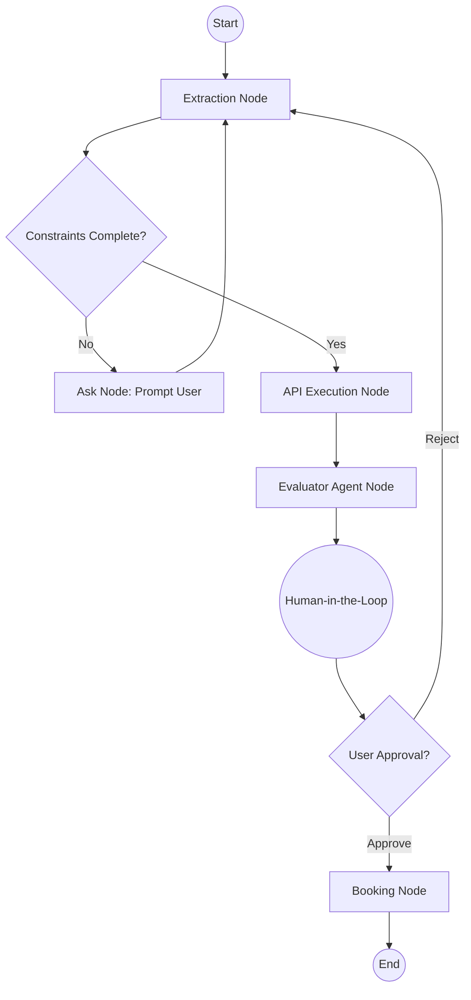

# Travel Agent - Design Decisions

## 1. Pydantic Model Constraints

For the `TravelConstraints` model, I included the following fields:

- `destination` (str): The intended city or country for the trip. Essential for querying hotel APIs and flight data.
- `start_date` (str): The beginning date of the trip. Required to check hotel availability.
- `end_date` (str): The ending date of the trip. Combined with start date to calculate the total duration and total cost of the stay.
- `budget` (float): The maximum amount the user is willing to spend. This is critical for the `Evaluator Agent` to filter out overly expensive options and penalize hotels that exceed the budget.

**Why these constraints?**
These four fields represent the absolute minimum information needed to plan and book a trip. Without a destination, we cannot search. Without dates, we cannot confirm availability or calculate stay length. Without a budget, we cannot filter or score accommodations appropriately for the user's financial limits.

## 2. State Flow Between Nodes

The `TravelState` inherits from `TypedDict` and carries the execution context through the graph:
1. **Initial Input**: The user provides a `query` (e.g. "I want to go to Paris").
2. **Extraction Node (`extract`)**: The system parses the query to populate the `constraints` object. If fields are missing, it appends them to the `missing_fields` list and sets `is_complete = False`.
3. **Conditional Routing (`check_constraints`)**: 
   - If `is_complete == False`, it routes to the **Ask Node**, which simulates prompting the user for the missing fields, then loops back to the Extraction Node.
   - If `is_complete == True`, it routes to the **API Node**.
4. **API Execution (`api`)**: Fetches mock hotel data based on the now-complete constraints, storing it in `mock_hotels` in the state.
5. **Evaluator Agent (`evaluator`)**: Reads `mock_hotels` and scores them based on a combination of rating and how well the total estimated cost fits the `budget`. The top 2 are stored in `top_hotels`.
6. **Human-in-the-Loop (`hitl`)**: Pauses to present `top_hotels` to the user. The state awaits a `user_approved` boolean.
7. **Approval Routing (`check_approval`)**:
   - If user rejects, the system loops back to the Extraction Node to modify constraints.
   - If user approves, it routes to the **Booking Node**.
8. **Booking Node (`booking`)**: Executes the mock POST request, generates a booking reference, and stores it in `booking_confirmation`, concluding the graph.

## 3. Workflow Graph

