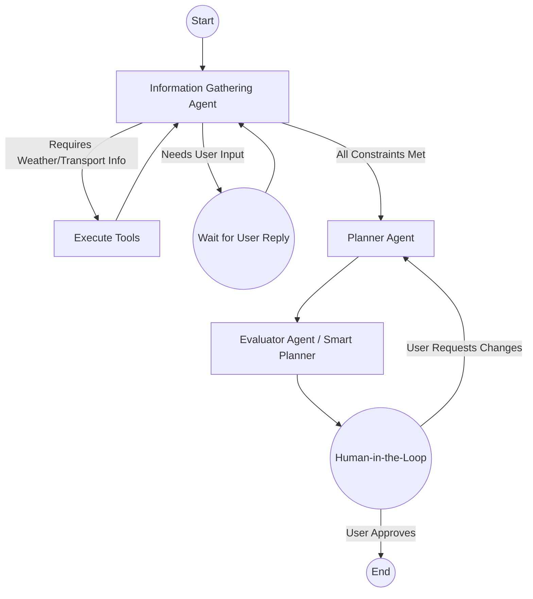

# AI Travel Agent: Design Decisions & Architecture

This document tracks the technical decisions made while building this conversational travel agent.

## Architecture Pattern: Conversational Agent with LangGraph

We have moved from a rigid, static DAG (where extraction and API calls happen in a fixed sequence) to a dynamic, LLM-powered **Conversational Agentic Workflow**.

### Core Flow & Graph Nodes

### Agent Roles

1. **Information Gathering Agent (Chatbot)**
   - **Role**: Converses with the user to dynamically fill out required constraints (Destination, Dates, Budget, Companions, Vibe, Transport).
   - **Capabilities**: Uses tools (`check_weather`, `search_transport_options`) to gather contextual information. For example, if the user mentions Colombo, it automatically checks the weather. If it's raining, it warns the user before proceeding to planning.
   - **LLM**: Powered by `openai/gpt-oss-20b` (migrated from Groq). It extracts constraints into raw JSON without structured output constraints to prevent tool hallucinations.

2. **Planner Agent**
   - **Role**: Once the chatbot determines all constraints are filled and the user is ready, the Planner Agent kicks in. It fetches real hotels (via RapidAPI or Google Places API fallback) and activities (via DuckDuckGo) based on the user's constraints.
   - **Error Handling**: If APIs fail entirely, it utilizes robust fallback strategies or surfaces the error to the state so the user is informed.
   
3. **Evaluator Agent (Smart Planner)**
   - **Role**: Scores the drafted itinerary based on predefined rules (e.g., budget penalties, rain penalties for sightseeing). It then uses the LLM (`openai/gpt-oss-20b`) to intelligently sequence the activities into a structured, day-by-day itinerary. It factors in travel time, check-in, pacing, and prevents repetitive activities.

4. **Human-in-the-Loop (HITL) Checkpoint**
   - **Role**: Pauses the execution. Sends the beautifully formatted smart itinerary to the UI. If the user approves, the flow terminates. If the user requests changes, it cycles back to the planner.

## State Management (`state.py`)
We use LangGraph's `add_messages` reducer to maintain a persistent chat history across the websocket connection. The `MemorySaver` checkpointer ensures that when the graph pauses at the HITL node, it perfectly resumes upon receiving the user's decision.

## UI/UX (WebSocket)
The frontend (`static/index.html`) is a chat interface that streams AI responses. When the `hitl` node is reached, the chat input is hidden, and an interactive itinerary review box is displayed. 
